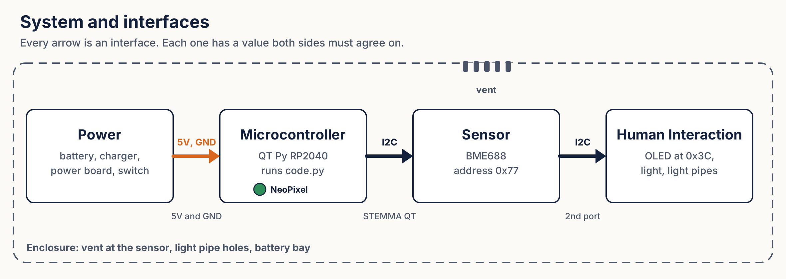
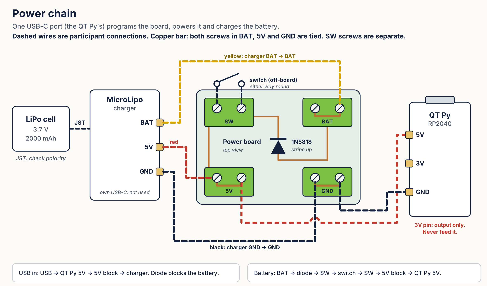

# Set-Point Monitor: a jigsaw build

A small device that reads temperature and humidity, compares each to a good range, and shows LOW, OK or HIGH on a screen and a color light.

It is built by a team of five roles. Each role owns one part, teaches it to the others, and the team assembles one working device. With six people, two share Microcontroller + Code.

Repository: [github.com/eb8ga/FYEC-Demo](https://github.com/eb8ga/FYEC-Demo/). QR code: [`docs/repo-qr.png`](docs/repo-qr.png).



## In the session

You do not need to install anything. The board is already set up.

1. **Prepare.** Read your role card, your reference guide, and your folder in [`subsystems/`](subsystems/). Write the 2 statements other teams most need to know from you on the [team worksheet](docs/team-worksheet.md).
2. **Share.** Human Interaction opens: what environment are we trying to measure? The room picks one application. Then each team shares its 2 statements.
3. **Ask.** Each team asks one question to one other team.
4. **Build** it together like a puzzle: there is no set order. Program the set points for your application, then test.
5. **Reflect.** The group picks a reflection question and talks it through.
6. **Exit ticket.** Write your own answer to that question, on the back of the worksheet.

| Who | Build task |
| --- | --- |
| Sensor + Microcontroller + Code | Sensor cable into the microcontroller's STEMMA QT port. |
| Power | Battery, charger and switch into the power board. |
| Microcontroller + Code | The QT Py's red and black wires into the 5V and GND blocks. Program and test once everything is connected. |
| Human Interaction | OLED from the sensor's free port. Light pipes in. |
| Mechanical | Seat every part in the case. Lid stays off until the test passes. |

Two rules:

- Switch OFF until everything is connected.
- The lid goes on last, after the test passes.

### What the light means

| Color | Meaning |
| --- | --- |
| GREEN | Both readings are inside their range |
| BLUE | Something is too LOW, and nothing is too high |
| RED | Something is too HIGH. HIGH wins over LOW. |

## What is in this repository

| Path | What it is |
| --- | --- |
| `device/CIRCUITPY/` | Everything that goes on the board's CIRCUITPY drive, laid out as it goes on the board. See [`device/README.md`](device/README.md). |
| `device/CIRCUITPY/code.py` | The program. Set points are in section 2. |
| `device/CIRCUITPY/font5x8.bin` | The font the OLED uses. Top level of the drive, not in `lib`. |
| `device/CIRCUITPY/lib/` | The Adafruit libraries, built for CircuitPython 10.x. `adafruit_bus_device` is its own folder. |
| `device/requirements.txt` | Library list for circup, if your board runs another version |
| `subsystems/` | One folder per role: Adafruit Learn guides, datasheets, design files |
| `cad/` | 3D models of the boards for laying out the enclosure |
| `fab/` | Gerber and drill files for making the boards |
| `docs/role-cards/` | The role cards, one per role |
| `safety/` | Tool safety, one folder per tool |
| `docs/team-worksheet.md` | The team worksheet, with the exit ticket |
| `docs/diagrams/` | System diagram and power chain |
| `docs/troubleshooting.md` | Fixes for the problems we hit |
| `handouts/` | Print-ready role cards and team worksheet |
| `tools/fetch-datasheets.sh` | Downloads local copies of the datasheets |
| `LICENSE` | MIT |

## Parts

| Part | Notes |
| --- | --- |
| Adafruit QT Py RP2040 | The microcontroller. Runs CircuitPython. |
| Adafruit BME688 on STEMMA QT (5046) | I2C address 0x77 (or 0x76). We use temperature and humidity only. |
| 0.91" 128x32 SSD1306 OLED module (MakerFocus) on a custom STEMMA QT breakout | I2C address 0x3C. Daisy-chained from the sensor. Board files in `subsystems/human-interaction/oled-breakout/`. |
| Onboard NeoPixel | The status light, on the QT Py. |
| Light pipes | 3D-printed in PETG. Two, in 5 × 5 mm square holes in the cover: one over the QT Py's NeoPixel (25 mm), one over the charger's charge LED (38 mm). Files in `fab/enclosure/` and `cad/enclosure/`. |
| 3.7 V 2000 mAh LiPo with protection circuit | Check the JST polarity before connecting. |
| Adafruit Micro-Lipo USB-C charger (4410) | Charger only. Its own USB-C port is not used. Charge rate is a team decision: see `subsystems/power/`. |
| Power board | Four 2-position screw terminals and a 1N5818 diode. SW and BAT on top, 5V and GND on the bottom. In BAT, 5V and GND both screws are tied; the two SW screws are separate. |
| Slide switch | Off-board. Its two wires go in the SW block. |
| 3D-printed enclosure | PLA, 60 × 90 × 46 mm. Cover: sensor vent, display window, light pipe holes. Body: USB-C opening, switch hole, battery bay. |
| Heat-set inserts (CNC Kitchen) | M2.5 x 4 mm for the circuit boards, M3 x 5 x 4 (Voron) for closing the enclosure. See `safety/heat-set-insert-press/`. |
| Screws | Nylon M2.5 for every circuit board. Stainless steel M3 socket head cap screws (SHCS) for the enclosure cover. |
| 2 STEMMA QT / Qwiic cables | QT Py to sensor, sensor to OLED. |

## Power

One USB-C port, the QT Py's, programs the board, powers it and charges the battery.



- Wire colors: yellow is the battery (charger BAT to the BAT block), red is 5V, black is ground.
- Yellow never goes in the 5V block. That bypasses the diode.
- Never connect power to the QT Py `3V` pin. It is an output.
- Leave the jumper on the back of the QT Py open.
- On battery there is no serial output. The screen and the lights are the only readout.

## Build your own from scratch

1. Install CircuitPython for the QT Py RP2040 from [circuitpython.org](https://circuitpython.org/board/adafruit_qtpy_rp2040/). Hold the BOOT button while plugging in USB, then drag the `.uf2` file onto the drive that appears.
2. Copy everything in `device/CIRCUITPY/` to the CIRCUITPY drive: `code.py` and `font5x8.bin` at the top level, and the `lib` folder.
3. The libraries are built for CircuitPython 10.x. If `boot_out.txt` shows another version, see [`device/README.md`](device/README.md).
4. Open a serial console. You should see two I2C addresses, `0x3c` and `0x77`, then a reading every half second.

On a Mac, copying files adds `._` files. They are usually harmless. `dot_clean /Volumes/CIRCUITPY` removes them. Eject the drive before unplugging.

## Changing the set points

Open `code.py` and edit section 2. Save. The board restarts the program on its own.

```python
TEMP_MIN_C = 20.0       # temperature below this is LOW
TEMP_MAX_C = 26.0       # temperature above this is HIGH
HUM_MIN_PCT = 40.0      # humidity below this is LOW
HUM_MAX_PCT = 60.0      # humidity above this is HIGH
```

Set them from the room's live readings. A breath trips humidity in seconds. Temperature is slow, so use a warm hand.

## Try this next

1. Change the set points so the light turns red when you breathe on the sensor. Which reading trips first, and why?
2. Make LOW yellow `(255, 150, 0)` instead of blue.
3. Add hysteresis so the light does not flicker at a limit.
4. Add a third set point for air pressure (`sensor.pressure`) and a third line on the display.
5. How would you add a battery gauge? (Hint: a voltage divider to an analog pin.)

## Credits

- `font5x8.bin` and the libraries in `lib/` are from Adafruit (MIT license). See [`device/README.md`](device/README.md).
- 3D models: Adafruit (MIT license) and GrabCAD. See [cad/README.md](cad/README.md).

Lesson, code, power board and OLED breakout by Eric Bredder, PhD.

## License

MIT. See [LICENSE](LICENSE). This covers the code, the role cards and handouts, the power board, the OLED breakout and the enclosure.

Third-party files keep their own licenses: the Adafruit libraries and CAD models (MIT, see [device/README.md](device/README.md) and [cad/README.md](cad/README.md)) and the GrabCAD OLED module model inside the OLED breakout's KiCad zip (GrabCAD terms).
