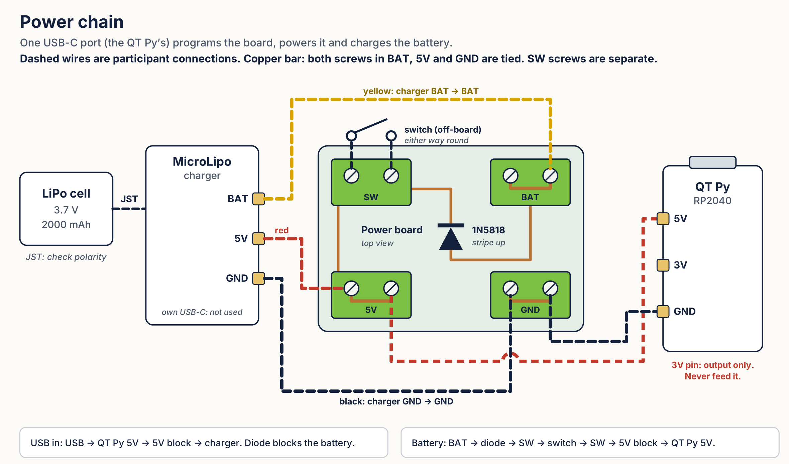

# Role card: Power

**Your part:** LiPo battery, MicroLipo charger, power board (four screw terminals and a diode), slide switch

**In one sentence:** It gets energy to the microcontroller from USB or from the battery, and charges the battery when USB is plugged in.

## Reference guide

- One USB-C port does everything: the QT Py's port. The charger's own USB port is not used.
- Battery path: battery → charger → BAT block → diode → switch → the 5V line.
- The diode is a one-way valve. With USB plugged in, it stops the battery from pushing back onto the line.

## Only you know

- The power board has four blocks: **SW** and **BAT** on top, **5V** and **GND** on the bottom. In BAT, 5V and GND both screws are tied together, so either screw works. The two SW screws are separate.
- Wire colors: **yellow** is the battery (charger BAT pad to the BAT block). **Red** is 5V (charger 5V pad to the 5V block). **Black** is ground (charger GND pad to the GND block).
- Yellow never goes in the 5V block. That skips the diode and ties the battery straight to USB 5V. Red in the GND block shorts 5V to ground.
- The switch's two wires go in the SW block, either way round. The diode's stripe points up, toward the SW block.
- 5V line: about 4.6 to 4.7 V on USB, 3.4 to 3.9 V on battery. Battery: 3.7 V LiPo, 2000 mAh.

## Design question

Charge at 100 mA or 500 mA (the charger's rate jumper)? What does each cost in charge time, and what does the battery datasheet allow?

## Interfaces

- **You give:** The 5V line at the 5V block and ground at the GND block, ready for Microcontroller + Code.
- **You need:** Leave one free screw in the 5V block and one in the GND block for the QT Py's red and black wires.

## Your build task

Switch OFF. Battery into the charger's JST port. Then from the charger: yellow BAT into the BAT block, red 5V into the 5V block, black GND into the GND block. Switch wires into the SW block. Tighten and tug each wire.

## If something goes wrong

Device dead on battery but fine on USB: check the switch, then that yellow is in the BAT block.

## Check yourself

Why use a diode here instead of a plain wire from the battery to the 5V line?

## Power chain

